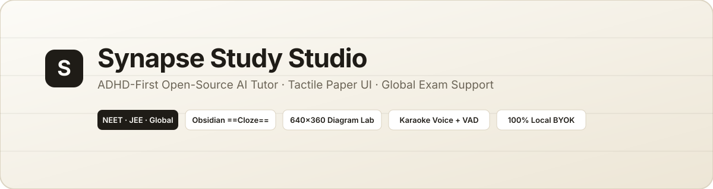
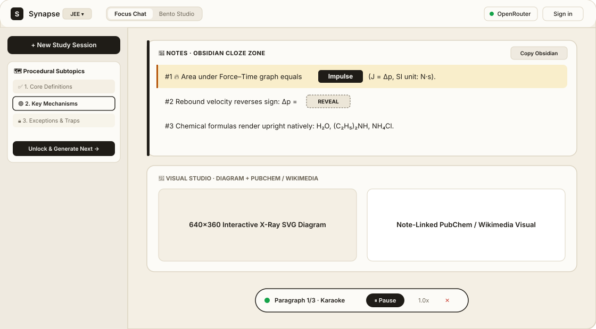
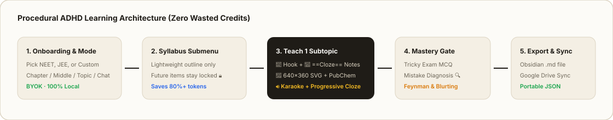

<p align="center">
  
</p>

<p align="center">
  <a href="LICENSE"></a>
  
  
  
  
</p>

<p align="center">
  <a href="#-support--donations"></a>
  <a href="#-support--donations"></a>
  <a href="#-support--donations"></a>
</p>

---

**Synapse Study Studio** is a free, open-source, **ADHD-first AI tutoring workspace** crafted to look and feel like studying on calm 120gsm cotton paper. Built as a single-file, zero-backend web application, it works with your own API keys (**BYOK**) across **OpenRouter, OpenAI, Anthropic Claude, Google Gemini, or any custom OpenAI-compatible endpoint**—supporting **NEET (UG), JEE Main & Advanced, UPSC CSE, SAT/AP/ACT, MCAT/USMLE, IB/A-Level, and any custom exam worldwide**.

## 🎨 Interface Preview

<p align="center">
  
</p>

>
---

## ✨ Key Capabilities

- **3-Step First-Run Onboarding**: Clean sign-in/sign-up (local profile or Google), Terms & Privacy consent, Exam & Font selection, and automatic API key + model detection before entering the workspace.
- **ADHD-First Micro-Chunk Teaching**: Strictly splits every reply into a `💬 CHAT` intuition zone (zero `==` symbols, zero greetings/fluff) and an Obsidian-ready `📝 NOTES` flashcard zone with click-to-reveal `==cloze==` blanks.
- **Procedural Credit-Saving Roadmaps**: Pick **📖 Learn a New Chapter**, **⏩ Middle of a Chapter** (auto-skips earlier topics), **🎯 Learn a Specific Topic**, or **💬 Just Chat**. Generates a lightweight syllabus submenu first and unlocks each subtopic one at a time only after mastery.
- **Per-Session Spaced Recall**: Independent **Feynman** (`1/3`) and **Blurting** (`1/2`) counters per session, session **Pin / Reorder / Delete**, plus **🔍 Assess My Mistake**, **💡 Explain Answer**, and **📖 Explain Whole Question** quiz diagnostics.
- **Math & Upright Chemistry Rendering**: Full KaTeX rendering plus automatic upright chemical formula formatting (`H₂O`, `(C₂H₅)₂NH`, `NH₄Cl`, ionic charges, and reaction arrows).
- **Dual Visual Studio**: Toggle between **640×360 Interactive X-Ray SVG Diagrams** (zoom, pause/animate, blind-label quiz) and **Note-Linked PubChem 2D Structures/Reactions + Wikimedia/Wikipedia** scientific visuals.
- **ADHD Karaoke Voice & Mic VAD**: Click **🔊 Listen** (or click any paragraph) for word-by-word karaoke highlighting, surrounding-paragraph focus dimming, progressive just-in-time cloze reveal, and a compact floating pause/resume dock. Supports browser-native speech or optional **ElevenLabs, OpenAI TTS/Whisper, Groq Whisper v3 Turbo, and Deepgram Nova-2** APIs with automatic silence detection (VAD).
- **Tactile Paper UI & Custom Fonts**: 120gsm cotton paper (light) and charcoal sketchbook (dark) themes, smooth cross-device spring animations, and global font switching (**Inter**, **Lexend**, **Verdana**, **Century Gothic**, **Space Mono**, **Atkinson Hyperlegible**, or any custom system/Google font).
- **100% Local Privacy + Optional Google Drive Sync**: Zero servers, zero ads, zero telemetry. Export/import portable `.json` backups anytime or connect your own Google OAuth Client ID for personal Google Drive sync.

---

## 🧠 Procedural Learning Architecture

<p align="center">
  
</p>

---

## 🚀 Quick Start (Deploy in 10 Seconds)

1. **Clone the repo**:
   ```bash
   git clone https://github.com/<your-username>/synapse-study-studio.git
   cd synapse-study-studio
   ```
2. **Run locally** by opening `index.html` in any modern browser — **or deploy free on GitHub Pages**:
   - Push this repo to GitHub → go to **Settings → Pages** → set Source to `main` branch (`/root`) → Save.
3. **Complete Onboarding**: Choose your exam profile, paper theme, font, and paste your AI API key (OpenRouter, OpenAI, Claude, Gemini, or Custom).

---

## ☁️ Enabling Live Google Sign-In & Personal Drive Sync (Optional)

1. Host `index.html` on an HTTPS URL (GitHub Pages, Netlify, or Vercel).
2. In [Google Cloud Console](https://console.cloud.google.com/), enable **Google Drive API** and create an **OAuth 2.0 Web Client ID** with your hosted URL under *Authorized JavaScript origins*.
3. Open Synapse → **Sign in** → **Connect live Google Drive API (Advanced ▾)** → paste your Client ID.

---

## 💖 Support & Donations

If Synapse helps you stay focused and study smarter, consider supporting open-source development:

<p>
  <a href="https://github.com/sponsors/alokgunawat"></a>
  <a href="https://buymeacoffee.com/alokgunawat"></a>
  <a href="https://ko-fi.com/alokgunawat"></a>
</p>

---

## 📄 License & Open-Source Attribution

Licensed under the **[MIT License](LICENSE)**. Built with open-source libraries (Tailwind CSS, KaTeX, Lucide Icons, Google Fonts) and public open-knowledge endpoints (PubChem, Wikipedia, Wikimedia Commons). Synapse is an independent community project and is not affiliated with any exam board or textbook publisher.
